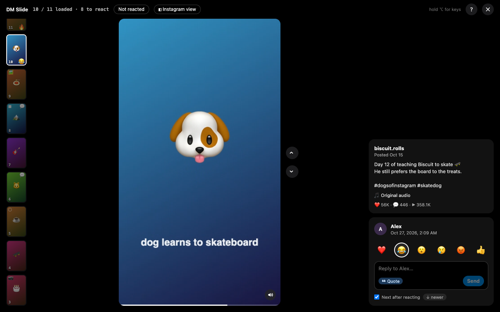
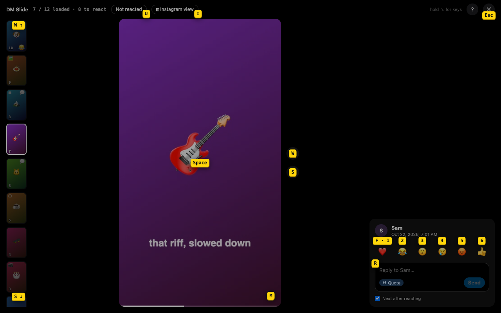
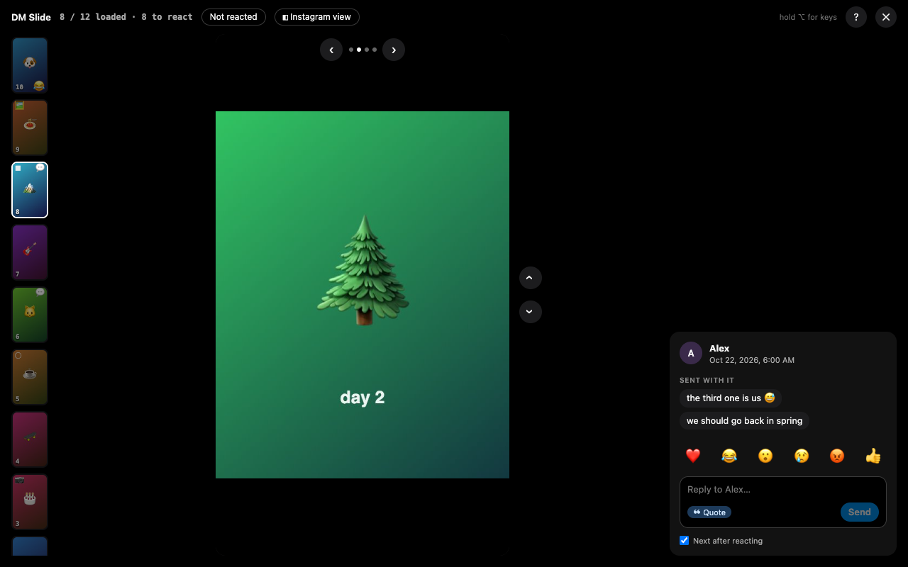
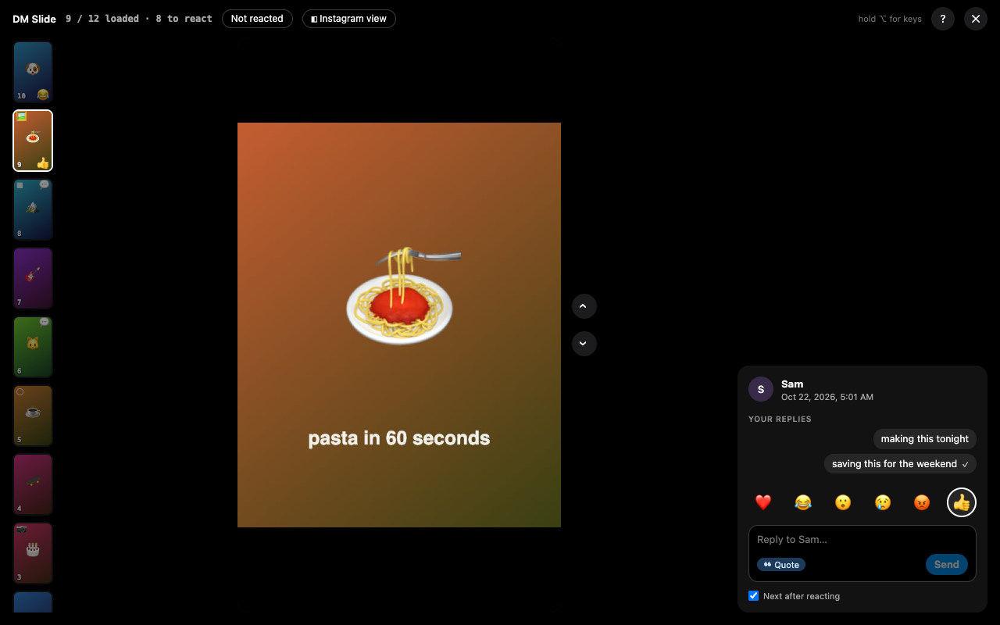

# DM Slide

A Chrome extension that plays everything sent to watch in an Instagram DM conversation — reels,
posts, carousels, stories and gallery photos or videos — one after another, so you can watch, react
and reply on one screen, without the back-and-forth.

*Screenshots come from the demo page: invented people and generated media.*

## Install

**From the Chrome Web Store:** [DM Slide](https://chromewebstore.google.com/detail/dm-slide/emfeebonhnagffgomdbpflehhjccefin) — press **Add to Chrome**.

**From a release zip** (no build needed):
1. Download `dm-slide-vX.Y.Z.zip` from the [latest release](https://github.com/lfernandogunther/dm-slide/releases/latest)
   and unzip it.
2. Open `chrome://extensions`, turn on **Developer mode** (top right), click **Load unpacked** and
   pick the unzipped folder.

**From source:**
1. `npm install`, then `npm run build` (or `npm run watch`); the extension lands in `dist/`.
2. In `chrome://extensions`, turn on Developer mode, then **Load unpacked** and pick `dist/`.
3. After each rebuild, press reload on the extension's card.

Chrome on desktop only.

## Use it
1. Open a conversation at [instagram.com/direct](https://www.instagram.com/direct/inbox/).
2. Press **▶ DM Slide** in the conversation's header — it shows how many items still wait for your
   reaction — or click any shared reel or post in the chat to start from that one.
3. The player opens on the oldest item you haven't reacted to or answered, among the messages
   already loaded (the newest such one if reacting moves older, see below). Watch, react, reply, and
   move on. **Esc** closes it.

The first time, a card lists the keys; press any key to start. Hold **Option** (Alt) or press **?**
to see each control's key next to it.

## Keys

| Key | Does |
|---|---|
| **W** or **↑** | Previous item; at the oldest loaded one, loads one more page of the chat |
| **S** or **↓** | Next item |
| **A** or **←** | Previous slide of a carousel; on anything else, the previous item |
| **D** or **→** | Next slide of a carousel; on anything else, the next item |
| **Space** | Pause / play |
| **M** | Mute / unmute (hover the sound button for the volume) |
| **F** or **1** | React ❤️ |
| **2** – **6** | React 😂 · 😮 · 😢 · 😡 · 👍 |
| **R** | Reply: Enter sends, Esc leaves the box |
| **U** | Show only what you haven't reacted to |
| **I** | Open the item in Instagram's own view, with DM Slide's bar on top; Esc, ✕ or I brings the player back |
| **?** | Show or hide the key tips and the key card |
| **Option** (Alt), held | Show the key tips while held |
| **Esc** | Close the player |

Pressing your current reaction again removes it. With **Next after reacting** on (the default),
reacting moves to the next newer item at once; the **↓ newer** button beside it switches that to
**↑ older**, which stops at the oldest loaded item rather than loading more. Every key has a button too; the mouse is never required
and never in the way.

An item that can't play in the player opens in Instagram's own view by itself 2 s later, once per
visit, with its card counting down meanwhile (turn it off with **Open in Instagram when it can't
play here**). Over that view a yellow bar
keeps the player's keys: **W** / **S** step to the older or newer item, staying in Instagram's view
when that one can't play either; **F** reacts ❤️; **R** opens a reply box beside the bar, a reply in
the DM, never a comment on the post. **A** / **D** (or ← / →) turn a carousel there, and past its
ends, or with none, step like W / S; ↑ / ↓ are W / S. Drag the bar by **⋮⋮** to
see what is under it; it stays where you leave it, and a double-click puts it back on top.

## Privacy
DM Slide has no server, collects nothing and sends nothing anywhere. It reads the conversation you
have open, in your browser, to show it to you, and stores only its own settings (like the volume) on
your device. It acts only when you press a key or a button. Full policy: [PRIVACY.md](PRIVACY.md).

## Limitations
- It reads Instagram's page, which changes without notice. When it can't read a conversation, it
  says so and does nothing — no reaction, no reply. An update follows.
- Only what was sent to watch: no text, voice messages, GIFs, stickers or links to other sites.
- No live updates while the player is open; items that arrive meanwhile show up on the next open.
- A reply that doesn't quote the item can't be tied back to it, so it shows only until you move on.
- Reactions and replies go to the DM message, never to the post itself.
- Not affiliated with, endorsed by or sponsored by Instagram or Meta.

## Development
- `npm run build` / `npm run watch` — build the extension into `dist/`.
- `npm run typecheck` — TypeScript, no emit.
- `npm run demo` — the real player over a fake conversation at http://127.0.0.1:8123/, with
  generated media and invented people. Query switches for states: `?fail=1` (actions fail),
  `?failOlder=1`, `?delay=<ms>`, `?video=0`, `?layer=0`, `?notice=1`.
- `npm run release <version>` — bumps `manifest.json` and `package.json`, commits, tags
  `v<version>` and pushes. The tag's workflow builds, typechecks, checks the tag against the
  manifest, attaches the zip to a GitHub Release and, once the store is configured, submits it to
  the Chrome Web Store.

Stack: Manifest V3, TypeScript, esbuild; the player is vanilla DOM in a Shadow DOM overlay. How it
reads Instagram and the traps found on the way: [NOTES.md](NOTES.md).

- Principles: [constitution.md](constitution.md)
- Roadmap: [ROADMAP.md](ROADMAP.md)
- Specs: [01 MVP](specs/01-mvp/spec.md) (clickable prototype in `specs/01-mvp/prototype/`),
  [02 Beyond reels](specs/02-beyond-reels/spec.md),
  [03 Player polish](specs/03-player-polish/spec.md),
  [04 Web Store release](specs/04-web-store-release/spec.md),
  [05 Post caption](specs/05-post-caption/spec.md),
  [06 No bot footprint](specs/06-no-bot-footprint/spec.md),
  [07 Faster video start](specs/07-faster-video-start/spec.md)

## License
[MIT](LICENSE)
